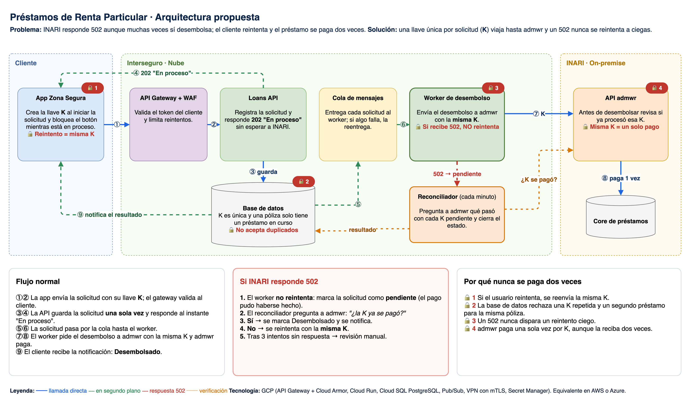

# Ejercicio 3 – Préstamos de Renta Particular

Diagrama editable: [`prestamos-renta-particular.drawio`](prestamos-renta-particular.drawio) (abrir con draw.io
Desktop o app.diagrams.net). La imagen de `img/` se exporta desde ese archivo.



## Problema

El 502 del proxy de INARI **no significa que el préstamo falló**: significa que el resultado es desconocido, porque
admwr sigue procesando y muchas veces desembolsa. Como cada reintento del cliente es una operación nueva y nada
la relaciona con la anterior, el sistema termina desembolsando varias veces.

## Solución

Tres ideas sostienen el diseño:

1. **Una intención = una llave.** La Zona Segura genera un `Idempotency-Key` (UUID) por intención de préstamo y la
   misma llave viaja hasta admwr. La BD la protege con `UNIQUE` y admwr deduplica en origen.
2. **El cliente no espera a INARI.** `POST /v1/loans` responde `202 Accepted` en milisegundos; el desembolso lo
   ejecuta un worker asíncrono y el cliente sigue el estado por SSE, polling o notificación push.
3. **Un 502 es "estado desconocido", no "fallo".** El worker marca `UNKNOWN` y no reintenta. Un reconciliador
   consulta admwr por la llave y solo reintenta (con la misma llave) si admwr confirma que no se ejecutó.

### Estados de la solicitud

`RECEIVED → QUEUED → SENT → DISBURSED | REJECTED`. Ante 502 o timeout, `SENT → UNKNOWN` (en el diagrama,
"pendiente"); el reconciliador lo lleva a `DISBURSED`, lo reencola con la misma llave o, tras N intentos sin
respuesta, a `MANUAL_REVIEW`.

### Modelo de datos (núcleo)

```sql
CREATE TABLE loan_request (
  id               UUID PRIMARY KEY,
  idempotency_key  UUID        NOT NULL UNIQUE,
  policy_id        VARCHAR(30) NOT NULL,
  customer_id      VARCHAR(30) NOT NULL,
  amount           NUMERIC(14,2) NOT NULL CHECK (amount > 0),
  currency         CHAR(3)     NOT NULL,
  request_hash     CHAR(64)    NOT NULL,  -- misma key con distinto payload => 422
  status           VARCHAR(20) NOT NULL,  -- RECEIVED | QUEUED | SENT | UNKNOWN | DISBURSED | REJECTED | MANUAL_REVIEW
  inari_operation  VARCHAR(40),
  attempts         INT         NOT NULL DEFAULT 0,
  next_check_at    TIMESTAMPTZ,
  version          INT         NOT NULL DEFAULT 0,
  created_at       TIMESTAMPTZ NOT NULL DEFAULT now(),
  updated_at       TIMESTAMPTZ NOT NULL DEFAULT now()
);

-- Una sola solicitud en curso por póliza: bloquea dobles clics, pestañas y dispositivos distintos.
CREATE UNIQUE INDEX uq_loan_active_per_policy ON loan_request (policy_id)
  WHERE status IN ('RECEIVED', 'QUEUED', 'SENT', 'UNKNOWN');

CREATE TABLE outbox (
  id           BIGSERIAL PRIMARY KEY,
  aggregate_id UUID        NOT NULL,
  event_type   VARCHAR(60) NOT NULL,
  payload      JSONB       NOT NULL,
  created_at   TIMESTAMPTZ NOT NULL DEFAULT now(),
  published_at TIMESTAMPTZ
);
```

Comportamiento de `POST /v1/loans`:

| Situación | Respuesta |
|---|---|
| Llave nueva y póliza sin solicitud en curso | `202` + `loanId`, estado `RECEIVED` |
| Misma llave y mismo payload (reintento, doble clic) | `200` con la solicitud existente y su estado actual |
| Misma llave, payload distinto | `422 IDEMPOTENCY_KEY_REUSED` |
| Llave nueva, pero la póliza ya tiene una solicitud en curso | `409 LOAN_IN_PROGRESS` con el `loanId` vigente |

## Evaluación según los criterios del reto

### Escalabilidad

- La API y el worker son contenedores sin estado (Cloud Run) que escalan horizontalmente por demanda; la API ya
  no retiene conexiones esperando a INARI, así que cada instancia atiende muchas más solicitudes.
- Pub/Sub absorbe picos (fin de mes, campañas) y el worker los drena **al ritmo que INARI soporta**: la
  concurrencia del worker es un parámetro (`max-instances` × `concurrency`) que protege a admwr de saturarse,
  que es justamente lo que hoy provoca los timeouts.
- La BD solo guarda solicitudes y outbox (escrituras pequeñas por clave primaria/única).

### Resiliencia y reintentos

| Falla | Tratamiento |
|---|---|
| 502 / 504 / timeout de INARI | `UNKNOWN` → reconciliación por llave; nunca reintento ciego |
| admwr confirma que no ejecutó | Reintento con la **misma** llave, backoff exponencial con jitter |
| INARI caído de forma sostenida | Circuit breaker abierto: los mensajes esperan en la cola, sin martillar a INARI |
| Mensaje que falla repetidamente | DLQ + alerta; no bloquea al resto |
| Caída de la API tras escribir en BD | Outbox: el evento se publica igual cuando el relay reintenta |
| Mensaje entregado dos veces (at-least-once) | Transición condicionada `WHERE status = 'QUEUED' AND version = v`; el duplicado no cambia nada |
| Sin respuesta tras N intentos / SLA | `MANUAL_REVIEW` + alerta a Operaciones; nunca se desembolsa por adivinanza |

### Control de concurrencia

Cuatro capas, de la más barata a la más fuerte:

1. **UX:** el botón se deshabilita mientras hay una solicitud en curso y la llave se reutiliza en cada reintento.
2. **BD:** `UNIQUE(idempotency_key)` y el índice único parcial por póliza resuelven carreras entre pestañas,
   dispositivos o instancias de la API, sin locks distribuidos.
3. **Bloqueo optimista:** cada transición de estado exige la `version` leída; dos workers o un worker y el
   reconciliador no pueden pisarse. El reconciliador toma lotes con `FOR UPDATE SKIP LOCKED`.
4. **Origen:** admwr guarda la llave con `UNIQUE`; es la última garantía aunque todo lo anterior fallara.

### Seguridad

- Cloud Armor (WAF, OWASP Top 10, rate limiting por cliente) y API Gateway con OAuth2/JWT del IdP de la Zona Segura.
- La API toma `customer_id` del token, nunca del body; la póliza se valida contra el cliente autenticado.
- Conexión a on-premise solo por Cloud VPN / Interconnect con mTLS e IP allowlist; ningún componente de INARI
  queda expuesto a Internet.
- Secretos en Secret Manager; cada servicio con su service account de mínimo privilegio.
- Auditoría inmutable de cada transición (quién, cuándo, estado anterior/nuevo), datos sensibles cifrados y
  enmascarados en logs.

### Costo de implementación

| Fase | Alcance | Costo / esfuerzo |
|---|---|---|
| **0 · Contención** (días) | Llave de idempotencia + `UNIQUE` en BD + botón bloqueado + tratar 502 como "en proceso" y consultar estado | Muy bajo: sin infraestructura nueva. Elimina la mayoría de duplicados de inmediato |
| **1 · Desacople** (semanas) | `202` + cola + worker + outbox + SSE/polling | Bajo: Pub/Sub y Cloud Run se pagan por uso y entran en la capa gratuita en volúmenes bajos |
| **2 · Autocorrección** | Reconciliador, circuit breaker, DLQ, alertas, `MANUAL_REVIEW` | Bajo: un Cloud Run Job programado |
| **3 · Deduplicación en origen** | admwr acepta la llave y expone `GET /disbursements/{key}` | Depende del equipo de INARI; es el cambio de mayor valor y se negocia en paralelo |

No se propone Redis ni un broker propio: la BD relacional ya existente resuelve la concurrencia y los servicios
administrados evitan operar infraestructura adicional.

## Supuestos y alternativas

- **Si admwr no puede recibir la llave:** el reconciliador busca el movimiento por póliza + monto + ventana de
  fecha. Es menos preciso, por lo que las coincidencias ambiguas van a `MANUAL_REVIEW`.
- **Si el canal debe seguir siendo síncrono:** se mantiene la llave y la BD (fase 0) y la API espera hasta un
  tiempo límite corto; si vence, responde `202` con el estado `PENDING` en vez de un error.
- **AWS equivalente:** WAF + API Gateway, ECS Fargate o Lambda, RDS PostgreSQL, SQS con DLQ, EventBridge
  Scheduler y Site-to-Site VPN.

Las decisiones están registradas en [`adr/`](adr).
